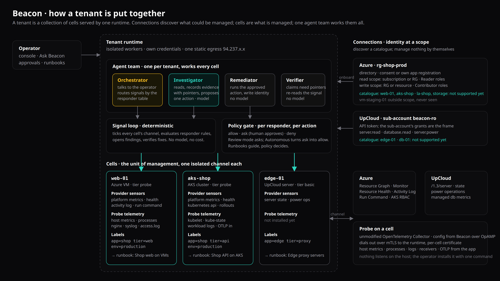

# Warden

Agentic reliability operations for teams on Azure and UpCloud without a full-time SRE. Warden is the agent that tends the estate and talks to you. Setup is three steps: create a tenant, give it a cloud credential, and from there the orchestrator takes over. All configuration is Warden's: runbooks from your words, watches ("watch the logs on edge-01 and wake me on errors"), standing orders ("add disk alerts for production and rotate the logs, pre-approved"), specialists from templates. The panel beside the thread shows what has been done. It has six setup tools (`get_setup_state`, `list_catalogue`, `onboard_cells`, `issue_grant`, `enable_api_access`, `install_probe`) behind a fixed policy table: onboarding and the grant run at once because they change nothing on your side until you act; API access and the probe change your cluster, so each opens an approval and runs when you approve it. It tells you what it found, what it can already see and do, and hands you the one thing to run when it needs more reach. There is no setup to learn.

Warden started on 2026-11-03 from the Beacon codebase (the Go service, the agent loop, the cell model, the design system and the documentation). Beacon stays as the hand-configured console; Warden is the agent-led one. The planning notes under `docs/planning/` were written for Beacon and still hold.

## What is here

| Path | What |
|---|---|
| `cmd/warden` | The binary: API, event stream, embedded console, signal loop, orchestrator. |
| `internal/domain` | Entities the console shows and the agents act on. No dependencies. |
| `internal/store` | In-memory system of record for one tenant plus the event bus. |
| `web/js/pages/home.js` | The home page: the orchestrator's thread beside the setup panel (tenant, connections, cells) rendered from `GET /api/setup`. |
| `internal/agent/skills.go` | Warden's skills beyond setup: runbooks by conversation, monitoring workflows, specialists from templates, routing a workflow hit to a responder. |
| `internal/setup` | Raises a tenant from a credential to a managed estate: onboarding, the grant, API access, the probe, and the setup overview (`GET /api/setup`). The API handlers and the orchestrator's setup tools both call it. |
| `internal/world` | Simulated estate: hosts, metric streams, services with versions, logs, files, activity. |
| `internal/scenario` | The faults the demo injects and the scripted playbook for each. |
| `internal/signal` | Deterministic signal loop: ticks the world, evaluates responder rules, verifies fixes. |
| `internal/agent` | Orchestrator, investigator reasoners (Claude and scripted), toolbox with the policy gate, remediator, usage accounting. |
| `internal/api` | HTTP handlers and the server-sent event stream. |
| `web/` | The console: vanilla ES modules on the Warden design system, embedded into the binary. `web/docs/` is the in-product documentation (the model, Azure and UpCloud step by step, the grant, the probe, security, how-to), served at `#docs` and read by the orchestrator through its `read_docs` tool. |
| `prototype/`, `design-system/`, `traffic-map/` | The published artifacts the app grew from. See `ARTIFACTS.md`. |
| `warden-initial-prd.md` | PRD v0.1. |
| `docs/planning/` | Design notes: the reviewed cell access model, the SSH hands design, the competitor study and the vendor research behind them. `web/docs/` is the customer-facing copy of that model. |

## Run it

```sh
./start.sh                      # batteries included: finds or fetches Go, builds, starts on :8080
./start.sh --dev                # same, with the console served from web/ so edits show on refresh
ANTHROPIC_API_KEY=... ./start.sh  # live mode: the investigator and orchestrator call Claude
```

`make run`, `make dev` and `make build` do the same for people who already have Go.

Open http://localhost:8080, sign in with anything, create a tenant, and follow the pulsing hint: validate a cloud connection, onboard what it discovered as cells, raise each cell from its page (or use the demo shortcut on the Cells page), then inject a fault from the demo bar at the bottom.



## The model

- A **tenant** is a collection of cells served by one **runtime**: isolated workers, its own credentials, one static egress address.
- A **connection** is an identity at a scope on a provider. It discovers what Warden could manage and with what access; it manages nothing by itself.
- A **cell** is the most specific managed thing: one VM, one cluster, one server. It came through one connection, has its own isolated channel in the runtime, and carries labels. Every cell has a **level of reach**: Level 0, connected, is the provider's view from outside. A VM reaches Level 1 when the operator runs the **Warden grant** on it (the probe and the SSH trust arrive together); a cluster reaches Level 1 with API access and Level 2 with the probe. `web/docs/` holds the exact steps per level and provider, and `docs/planning/cell-access-model.md` the reviewed model behind them.
- A cell shows two layers: **provider sensors**, what the connection gives for free, and **probe telemetry**, what the probe on the cell collects. The probe is an unmodified OpenTelemetry Collector; its config is rendered from the telemetry settings and pushed over OpAMP. The investigator can only read what the telemetry enables.
- **Runbooks** are label selectors over cells. Owner and criticality are labels too. There is no app object: applications are discovered on a cell by the investigator and recognised by a runbook's *applies when* block. `docs/planning/apps-and-cells.md` has the reasoning.
- One **agent team** per tenant works every cell: the orchestrator the operator talks to, the specialists it starts, and the deterministic remediator and verifier. A run binds a specialist to one cell.

Settings are environment variables; see `.env.example`. `WARDEN_MODEL` defaults to `claude-opus-5-5`.

`make dev` serves the console from `web/` on disk, so a browser refresh shows every change without a rebuild. `make build` produces a single static binary in `bin/`. `docker compose up --build` runs it in a container.

## How a run works

1. The **signal loop** ticks the world once a second and evaluates the responder rules. No model is involved.
2. When a rule holds for its window, the **orchestrator** applies the responder table: it opens a finding and a run and starts the responder's agent, the **investigator**, with a tool budget.
3. The investigator reads metrics, logs, activity and files through the **toolbox**, records evidence with source pointers and hypotheses with verdicts, and proposes exactly one action.
4. The **policy gate** decides: `allow` runs it now, `ask` opens an approval and pauses the run until a human decides, `deny` refuses it. A responder in Autonomous mode turns `ask` into `allow`.
5. The **remediator** executes the approved action against the world and records the provider response. It has no model.
6. The **verifier** marks the cause Verified only when every claim has a pointer, and the signal loop re-reads the triggering signal before the finding is resolved.

**Connections** need, on Azure, the Entra directory, an identity (consent to the Warden app, or bring your own app registration with a federated credential or certificate), a read scope for discovery and an optional, narrower write scope for fixes. Validation lists the role assignments, derives the capability list from them, and fills the catalogue of what is in scope. The remediator refuses an approved action when no connection's write scope covers the cell. An UpCloud connection is a sub-account token whose grants are the frame.

**Isolation.** At Warden's layer every cell has its own channel, policy, budget and audit trail, and a run can only touch the cell it was started for. At the provider's layer isolation is as good as the identity's scope: the Cells page says whether a cell's identity is dedicated or shared with other cells.

**Runbooks** are tenant-written Markdown attached to a label selector. The orchestrator hands every matching runbook to the investigator with the task, most specific first, and the run records which ones applied. A runbook guides; the responder policy still decides what may run.

The operator talks to the orchestrator on the Ask Warden page. It can list findings, describe resources, and start an investigation on request. Every model call is accounted per agent and per run on the Agents and Consumption pages.

## Scripted mode and live mode

Without `ANTHROPIC_API_KEY` the reasoners replay scenario playbooks through the same toolbox, so policy, approvals, evidence and verification behave exactly as with the model. Token usage is simulated at typical sizes and labelled as such in the console. With a key, the investigator and the orchestrator run a streaming tool loop on the model named in `WARDEN_MODEL`; the Agents page lets you change effort per agent.

## Development

```sh
make test   # go vet and the unit tests
make fmt
```

The console has no build step. The design system components in `web/js/ds.js` mirror `design-system/project/components/bundle.js`; change the design system first, then copy.
